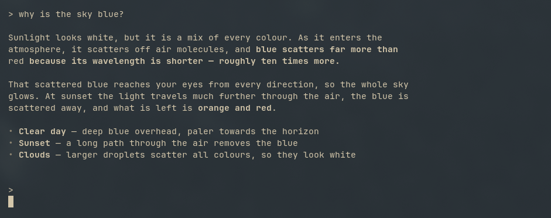

# deepseek-chat

DeepSeek in your terminal.



## What it is

A terminal front end for DeepSeek's web chat. The assistant you already use in
the browser, streamed as text into your shell.

There is no API key, no billing, and no third-party service in the middle. It
opens the real <https://chat.deepseek.com> in a browser you own, keeps its own
login, types your message into the real composer and prints the answer back.
Markdown survives the trip: headings, lists, code blocks and emphasis.

It is built for *talking* to DeepSeek — asking questions, thinking out loud,
working through something — not for wiring a model into an editor, an agent
loop or a script.

## Why this exists

Talking to a model from a terminal usually means one of two things: paying for
API tokens, or opening a browser tab. This is a third option that keeps the
free web experience but moves it to where the work actually happens — the shell.

Plainly, so there is no ambiguity about what this project is for:

- It is for a person chatting. One message, one answer, at a human pace.
- It is **not** a botting tool. Nothing here runs unattended, sends in bulk,
  farms accounts, scrapes conversations, or pools sessions together.
- It does **not** bypass DeepSeek's limits, paywalls or authentication. You
  sign in with your own account, and the free tier you see in the browser is
  the same free tier you get here.
- It **does not** call private endpoints. It drives the visible page, the same
  way your hands would.

The point is convenience, not extraction. Whether it counts as acceptable is
DeepSeek's call, not ours — if you want something unambiguously sanctioned for
programmatic work, use their API at <https://platform.deepseek.com>. It is
free to create a key and it is the right tool for anything automated.

## How it works

1. `--login` launches the browser you already use, with your own flags, but a
   separate profile at `~/.local/share/deepseek-chat`. Your daily browser is
   never read, written or locked.
2. The session is stored in `session.json` after signing in and re-injected on
   every start, so the login survives restarts without a second sign-in.
3. A message is typed into the real composer and sent with a real keypress,
   with small pauses, rather than fired at the network directly.
4. The answer is re-read from the page as it renders and streamed to stdout, so
   it appears line by line while the model is still writing.
5. Output is plain stdout: styled on a terminal, raw Markdown when piped, and
   never inside an alternate screen. Scrollback, `grep` and redirects all work.
6. One conversation at a time. When idle, nothing is running except the browser
   holding your page.

## Usage

### Signing in, once

```bash
deepseek-chat --login
```

This opens a **normal browser window** — no debugging port, no automation
flags, nothing attached to it at all. Sign in the way you normally would, then
close the window (or press `enter` in the terminal if it keeps running in the
background).

dsx then marks the session cookie persistent at the profile level, reloads the
page once to confirm the chat interface actually appears, and tells you whether
it worked. From then on no window is needed.

Why it is done this way: DeepSeek treats a browser driven over the DevTools
protocol as a new device, and answers with an emailed-code CAPTCHA that cannot
be completed from an automation window. Signing in with a plain browser avoids
that entirely — the login looks exactly like your daily browsing, because it
is. Everything after login is ordinary page interaction.

If you normally sign in with Google or Apple, that works here too.

### Chatting

```bash
deepseek-chat                            # interactive
deepseek-chat -p "why is the sky blue"   # one answer, then exit
echo "summarise this in 3 bullets" | deepseek-chat
```

Interactive mode is an ordinary REPL: nothing takes over the screen, answers
scroll back, `ctrl+c` quits.

| Key | Action |
| --- | --- |
| `enter` | send |
| `\` at the end of a line | continue on the next line |
| `up` / `down` | previous prompts |
| `ctrl+r` | search history |
| `ctrl+c` | quit |

| Command | Action |
| --- | --- |
| `/new` | start a new conversation |
| `/reload` | reload the page |
| `/browser` | raise the browser window |
| `/think` | show or hide the model's reasoning |
| `/clear` | clear the screen |
| `/quit` | exit |

| Flag | Action |
| --- | --- |
| `-p`, `--print <TEXT>` | one prompt, print the answer, exit |
| `--login` | sign in with a plain browser window |
| `--headed` | show the browser window |
| `--headless` | no window (default) |
| `--think` | also print the reasoning |
| `--no-color` | plain text, no ANSI |
| `--probe` | print page diagnostics and exit |
| `--say <TEXT>` | with `--probe`, send this and stream the answer |

The long name is a mouthful, so an alias helps:

```bash
alias dsx=deepseek-chat
```

### Examples

```bash
deepseek-chat -p "explain the difference between TCP and UDP, briefly"
deepseek-chat -p "rewrite this email to sound less annoyed" < draft.txt

# reasoning, when you want to see how it got there
deepseek-chat --think -p "is 0.1 + 0.2 == 0.3 in floating point?"

# clean Markdown into a file
deepseek-chat -p "write a short guide to brewing pour-over coffee" > coffee.md
```

### When something looks wrong

```bash
deepseek-chat --probe --say "reply with pong"
```

This runs the whole pipeline in a plain terminal and prints what it sees: login
state, the composer it found, the cookies it can read, the last answer, and a
browser fingerprint summary. It tells you whether a failure is auth, a
selector, or the network.

DeepSeek changes its frontend occasionally. When that happens, adjust the
selectors in `~/.config/deepseek-chat/config.toml`; no rebuild needed.

## Installation

**Requirements:** Rust 1.88+ and Chromium or Google Chrome on `PATH`.

```bash
git clone https://github.com/batusaribay/deepseek-chat.git
cd deepseek-chat
cargo build --release
cargo install --path . --locked
```

Or straight from the repository:

```bash
cargo install --git https://github.com/batusaribay/deepseek-chat.git --locked
```

The binary is installed as `deepseek-chat`.

## Configuration

`~/.config/deepseek-chat/config.toml` is created on first run:

| Key | Meaning |
| --- | --- |
| `headless` | run the browser without a window |
| `stealth` | report `navigator.webdriver` the way a normal browser does |
| `chrome` | browser binary to use |
| `poll_ms` | how often the answer is re-read from the page |
| `settle_ms` | how long text must stand still before an answer is finished |
| `composer_selector` | where messages are typed |
| `answer_selector` | what counts as an answer |
| `think_selector` | the reasoning block |

`.ds-markdown` is DeepSeek's own class for a rendered answer. If a release
renames it, `--probe` shows the candidates on the live page.

## Limitations

- It is browser automation. DeepSeek can change the page, and a CAPTCHA can
  still decide it does not like the browser; the tool cannot guarantee
  otherwise.
- The interface is the website's, so anything not in the page is not available
  here: model pickers, file uploads and the sidebar are absent by design.
- One session, one conversation, one message at a time.

## Security

- A dedicated profile at `~/.local/share/deepseek-chat`; your own browser
  profile is never opened, copied or modified.
- The saved session lives in `session.json` with mode `0600`, and the config
  directory is private.
- No telemetry, analytics, or background polling.
- `--probe` prints cookie *names* and lengths, never their values.

## License

This project is licensed under the [MIT License](LICENSE).
